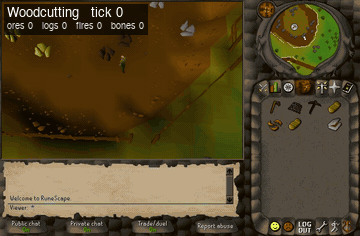

# runescape-agent

Can we train an agent to play RuneScape from game outcomes alone? We use recurrent PPO,
train in a C simulator and in the real game server, and test the agent in the real server.

The game runs on [rs-sdk](https://github.com/MaxBittker/rs-sdk), an open-source emulator of
the 2004 game server, so we can reset worlds, patch the engine and read the game state
directly.

Not affiliated with or endorsed by Jagex Ltd. RuneScape, its game art and its names are
the property of Jagex Ltd.

## 21 November 2026: goal-free play, and a skill it found by itself



One agent, one life of 21,073 ticks, about 230x normal speed ([video](docs/media/one-life.mp4)).
It started at a long life's levels and spent 69.5% of its time mining, 15.9% fighting and
12.0% cutting wood, with fires and bones in between: mining level 16 to 44, 683 ores, 105
logs, 57 fires and 24 bones buried, with no death.

What changed:

- The agent has no goal anymore. One policy plays whole lives and is paid the gain in its
  own levels, across every stat in the game. It still sees only what a player standing
  there could see.
- Training moved into the real engine. Many agents of one policy share each world of the
  real game server. The world stops at every tick where an agent needs a new action and
  waits while the learner trains. The C simulator stays as its tested twin.
- Directed exploration: a small extra pay for XP of a kind that is still rare for the
  agent. It falls as that kind of XP becomes common, and it names no skill.

What happened: the agent learned four skills by itself, then stopped there. In one seed's
late lives, 100% cut wood, 95% made fires, 69% fought and 37% buried bones. It didn't take
up mining even when we started its lives at the levels of a long life, where a rock's first
ores pay well, or turned up exploration. With the rare-XP pay, lives started at those
levels mined five ores or more in 15.1% and 13.6% of cases (two seeds), against 0.7% and
0.0% without it. We then switched the pay off for 25 more updates, and mining stayed and
grew, to 15.1% and 47.7%, with more levels than lives that were never paid. The pay gave the
first tries, and the game's own levels kept them.

The same learned agent changes its focus with its situation, with no new goal and no
script. From a fresh start it cuts and burns wood and fights. Started at a long life's
levels, where those pay little, it becomes a fighting specialist and spends 90 to 93% of its
time fighting. A short phase with the directed-exploration pay (25 updates, then 25 more
without it, about 45 minutes each on one T4 GPU) made it a mining specialist, as in the
clip above.

Limits: two seeds; mining shows on the long-life starts only (lives at their drawn levels
still rarely mine); deaths rose, on small counts (19 and 10 against 9 and 7 with the pay,
20 and 23 against 9 and 7 after it). The agent doesn't fish or cook, and it almost never
eats when hurt.

## 12 November 2026: one skill at a time

The first release trained one policy per skill (wood, fish, mine and melee), each told its goal, in the C
simulator, then tested it in the real engine. Each clip is one trial in the real engine.

| Wood | Fish |
| --- | --- |
|  |  |
| **Mine** | **Melee** |
|  |  |

Each skill has a fixed task with a pass mark set before training. These numbers come from the
saved evaluation runs, with sampled play on starts the agent never trained on. Items is the
average per trial, misses included. Ticks is the median tick at which a trial reached its goal,
among the trials that did (a tick is 0.6 seconds of game time).

In the simulator (200 starts per seed and pass, 800 for melee):

| Skill and goal | Policy | Items a trial | Reached the goal | Median ticks to the goal |
| --- | --- | --- | --- | --- |
| Wood: 8 logs in 300 ticks | Untrained | 1.3 logs | 0% | - |
|  | Phase 1 | 11.7 logs | 95% | 202 |
|  | Clicks | 10.3 logs | 80% | 219 |
| Fish: 2 fish in 240 ticks | Untrained | 0.3 fish | 4% | 105 |
|  | Phase 1 | 3.0 fish | 99% | 89 |
| Mine: 2 ore in 240 ticks | Untrained | 0.7 ore | 13% | 144 |
|  | Phase 1 | 3.3 ore | 98% | 94 |
|  | Clicks (1 seed) | 2.7 ore | 87% | 115 |
| Melee: 5 kills in 1,200 ticks | Untrained (1 seed) | 0.9 kills | 2% | 1,011 |
|  | Phase 1 | 9.6 kills | 96% | 449 |
|  | Clicks (1 seed) | 7.7 kills | 90% | 609 |

In the real engine (32 trials per seed and pass, at two sites per skill):

| Skill and goal | Policy | Items a trial | Reached the goal |
| --- | --- | --- | --- |
| Wood: 8 logs in 300 ticks | Untrained | 0.8 logs | 0.3% |
|  | Phase 1 | 14.2 logs | 99% |
|  | Clicks | 13.5 logs | 94% |
| Fish: 2 fish in 240 ticks | Phase 1 | 1.9 fish | 65% |
| Mine: 2 ore in 240 ticks | Phase 1 | 2.3 ore | 79% |
|  | Clicks (1 seed) | 1.4 ore | 52% |

Phase 1 and the click wood policy are five seeds each, with two sampled passes. Untrained is the
starting policy before any training (for melee, the click run's start). Wood here is the scarce
layout, where only one tree is left near the start. Every run uses 25 times the normal XP rate.
There's no fair real-engine test for melee yet. The limits on all of this are in
[docs/NOTES.md](docs/NOTES.md#results-in-detail).

## How it works

The agent is a recurrent PPO policy
([SB3-Contrib](https://github.com/Stable-Baselines-Team/stable-baselines3-contrib)'s RecurrentPPO with a faster
update), with an LSTM as its only memory. It sees what a player standing there could see: things within 15 tiles,
its inventory, the open interface and the game's text. It acts through 96 actions, like clicking a tile or a tree in
view. In the 21 November release it has no goal and is paid the gain in its levels over every stat. The 12 November
policies were told their goal and paid only for items they made and still held and for kills, with nothing if they
died. Every pay is checked by an audit of the game's own records. Training runs in the C port of the game's
mechanics or in the real engine itself, and the agent is tested in the real engine.

## Using the trained agent

The final policy of the 21 November release (the miner of the clip above, a `free-play-v14` policy trained 1,638,400
decisions after its line's earlier runs) is attached to the
[GitHub release](https://github.com/0x3ddie/runescape-agent/releases) as four files:

| File | What it is |
| --- | --- |
| `runescape-agent-2026-11-21.zip` | the policy, 37,581,569 bytes (about 36 MB), sha256 `3c8508e2a27f2e0d79ce1e9dbd27d2c3ff7493c884dc4ecf122dba54a1e4b1c5` |
| `runescape-agent-2026-11-21.names.json` | the fingerprint of the name table the policy trained with |
| `runescape-agent-2026-11-21.launch.json` | the training settings that the demo and the watch read |
| `runescape-agent-2026-11-21.sha256` | the checksums of the three files above |

The policy reads a table of name vectors built from the game's own files, so the zip holds none (its four name tables
are zero) and no file paths. You rebuild the table, and the loader fills the policy's tables from it. It takes your
table when its digest matches the trained one, or when it matches the fingerprint (the same names in the same order,
and per-dimension sums within 2^-8 of their scale); otherwise it refuses and says why. We checked this on one Mac only: a table
rebuilt on another machine hasn't been tested. The copy plays but can't start a training run.

1. Set up the engine and the two Python environments as in [docs/RUNNING.md](docs/RUNNING.md).
2. Rebuild the name table (`scripts/name_vectors.py` reads each name with
   sentence-transformers/all-MiniLM-L6-v2):

   ```sh
   bun scripts/cache_names.ts logs/names/cache-names.json
   .venv/bin/python scripts/name_vectors.py logs/names/cache-names.json logs/names/name-vectors.npz
   ```

3. Download the four files into one folder and check them. Keep the `.names.json` file beside the zip: the loader
   looks for it there.

   ```sh
   shasum -a 256 -c runescape-agent-2026-11-21.sha256
   ```

4. Play it with `sim.real demo` (one world you watch live in the web client) or `sim.watch`, passing
   `--real-checkpoint runescape-agent-2026-11-21.zip --launch runescape-agent-2026-11-21.launch.json`
   ([docs/RUNNING.md](docs/RUNNING.md#watching-a-demo)).

## Quick start

```sh
git clone https://github.com/0x3ddie/runescape-agent.git
cd runescape-agent
uv venv --python 3.12 .venv
uv pip install --python .venv/bin/python -r requirements.txt -r baseline/requirements.txt
.venv/bin/python -m pytest
```

That runs the learner and task tests with a small synthetic name table. Everything else
needs the engine and inputs built from its game data, which this repository does not
include. [docs/RUNNING.md](docs/RUNNING.md) says how to build them, run every test suite,
train and evaluate.

## Repository layout

- `sim/`: the simulators (a Python reference and its C port in `sim/native/`), the tasks and pays, the reward
  audit, the learner, training in the simulator and in the real engine (`sim/real.py`), the fixed watch
  (`sim/watch.py`) and the evaluation commands.
- `baseline/`: the policy network, real-engine evaluation and accounting.
- `rl/`: the observation, action, feedback, item and name contracts.
- `env-ts/`: the environment inside the real engine (TypeScript, Bun), with its shared lockstep worlds.
- `scripts/`: the world stack, name vectors, the arena map tool and an engine speed check.
- `vendor-patches/`: the engine patches and how to build the engine.
- `docs/`: the notes, the running guide and the clips.

## More docs

- [docs/NOTES.md](docs/NOTES.md): how we got here, from the first agent to goal-free play, and every result of the
  12 November release with its limits.
- [docs/RUNNING.md](docs/RUNNING.md): building the inputs, the tests, training (in the simulator and in the real
  engine), the watch and the demo.

## Credits and licence

- [rs-sdk](https://github.com/MaxBittker/rs-sdk) and the [Lost City](https://github.com/LostCityRS)
  engine it builds on (MIT). The patches change their source, and `sim/` and `env-ts/`
  port or call parts of it; see [NOTICE](NOTICE).
- [Stable-Baselines3](https://github.com/DLR-RM/stable-baselines3) and
  [SB3-Contrib](https://github.com/Stable-Baselines-Team/stable-baselines3-contrib) (MIT).

This repository's own code is under the licence in [LICENSE](LICENSE). Game assets, art
and names are not covered: they are the property of Jagex Ltd.
