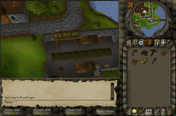
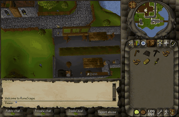
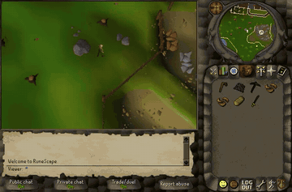
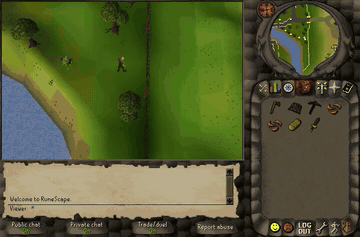

# runescape-agent

Can we train an agent to play RuneScape from game outcomes alone? We use recurrent PPO and
train with a C simulator, before testing agent performance in a RuneScape server.

The game runs on [rs-sdk](https://github.com/MaxBittker/rs-sdk), an open-source emulator of
the 2004 game server, so we can reset worlds, patch the engine and read the game state
directly.

Not affiliated with or endorsed by Jagex Ltd. RuneScape, its game art and its names are
the property of Jagex Ltd.

We started with four main skills:

| Wood | Fish |
| --- | --- |
|  |  |
| **Mine** | **Melee** |
|  |  |

## Results

Each skill has a fixed task with a pass mark set before training. These numbers come from the
saved evaluation runs, with sampled play on starts the agent never trained on. Items is the
average per trial, misses included. Ticks is the median tick at which a trial reached its goal,
among the trials that did (a tick is 0.6 seconds of game time).

In the simulator (200 starts per seed and pass, 800 for melee):

| Skill and goal | Policy | Items a trial | Reached the goal | Median ticks to the goal |
| --- | --- | --- | --- | --- |
| Wood: 8 logs in 300 ticks | Untrained | 1.3 logs | 0% | - |
|  | Phase 1 | 11.7 logs | 95% | 202 |
|  | Clicks | 10.3 logs | 80% | 219 |
| Fish: 2 fish in 240 ticks | Untrained | 0.3 fish | 4% | 105 |
|  | Phase 1 | 3.0 fish | 99% | 89 |
| Mine: 2 ore in 240 ticks | Untrained | 0.7 ore | 13% | 144 |
|  | Phase 1 | 3.3 ore | 98% | 94 |
|  | Clicks (1 seed) | 2.7 ore | 87% | 115 |
| Melee: 5 kills in 1,200 ticks | Untrained (1 seed) | 0.9 kills | 2% | 1,011 |
|  | Phase 1 | 9.6 kills | 96% | 449 |
|  | Clicks (1 seed) | 7.7 kills | 90% | 609 |

In the real engine (32 trials per seed and pass, at two sites per skill):

| Skill and goal | Policy | Items a trial | Reached the goal |
| --- | --- | --- | --- |
| Wood: 8 logs in 300 ticks | Untrained | 0.8 logs | 0.3% |
|  | Phase 1 | 14.2 logs | 99% |
|  | Clicks | 13.5 logs | 94% |
| Fish: 2 fish in 240 ticks | Phase 1 | 1.9 fish | 65% |
| Mine: 2 ore in 240 ticks | Phase 1 | 2.3 ore | 79% |
|  | Clicks (1 seed) | 1.4 ore | 52% |

Phase 1 and the click wood policy are five seeds each, with two sampled passes. Untrained is the
starting policy before any training (for melee, the click run's start). Wood here is the scarce
layout, where only one tree is left near the start. Every run uses 25 times the normal XP rate.
There's no fair real-engine test for melee yet. The limits on all of this are in
[docs/NOTES.md](docs/NOTES.md#results-in-detail).

## How it works

The agent is a recurrent PPO policy ([SB3-Contrib](https://github.com/Stable-Baselines-Team/stable-baselines3-contrib)'s
RecurrentPPO with a faster update), about 2.46 million parameters, with a 128-unit LSTM as its
only memory. It sees what a player standing there could see: things within 15 tiles, its
inventory, the open interface and the game's text. It acts through 96 actions, like clicking a
tile or a tree in view. It gets paid for items it made and still holds and for kills, checked
by an audit of the episode's records, and gets nothing if it dies. It trains in a C port of the
game's mechanics, 1,024 worlds at a time and 4.2 million decisions a run, then gets tested in
the real engine.

## Quick start

```sh
git clone https://github.com/0x3ddie/runescape-agent.git
cd runescape-agent
uv venv --python 3.12 .venv
uv pip install --python .venv/bin/python -r requirements.txt -r baseline/requirements.txt
.venv/bin/python -m pytest
```

That runs the learner and task tests with a small synthetic name table. Everything else
needs the engine and inputs built from its game data, which this repository does not
include. [docs/RUNNING.md](docs/RUNNING.md) says how to build them, run every test suite,
train and evaluate.

## Repository layout

- `sim/`: the simulator (a Python reference and its C port in `sim/native/`), the tasks,
  the reward audit, the learner, and the training and evaluation commands.
- `baseline/`: the policy network, real-engine evaluation and accounting.
- `rl/`: the observation, action, feedback, item and name contracts.
- `env-ts/`: the environment inside the real engine (TypeScript, Bun).
- `scripts/`: the world stack, name vectors and the arena map tool.
- `vendor-patches/`: the engine patches and how to build the engine.
- `docs/`: the notes, the running guide and the clips.

## More docs

- [docs/NOTES.md](docs/NOTES.md): how we got here, from the first agent to now, and every
  result with its limits.
- [docs/RUNNING.md](docs/RUNNING.md): building the inputs, the tests, training and evaluation.

## Credits and licence

- [rs-sdk](https://github.com/MaxBittker/rs-sdk) and the [Lost City](https://github.com/LostCityRS)
  engine it builds on (MIT). The patches change their source, and `sim/` and `env-ts/`
  port or call parts of it; see [NOTICE](NOTICE).
- [Stable-Baselines3](https://github.com/DLR-RM/stable-baselines3) and
  [SB3-Contrib](https://github.com/Stable-Baselines-Team/stable-baselines3-contrib) (MIT).

This repository's own code is under the licence in [LICENSE](LICENSE). Game assets, art
and names are not covered: they are the property of Jagex Ltd.
