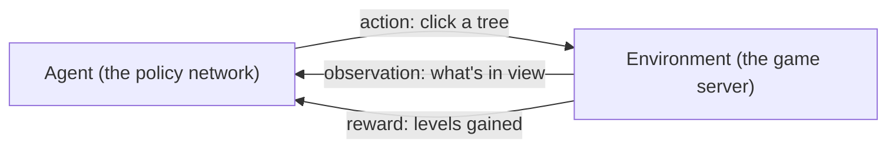
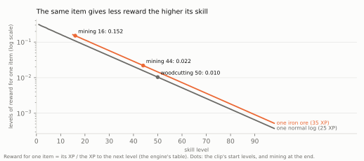
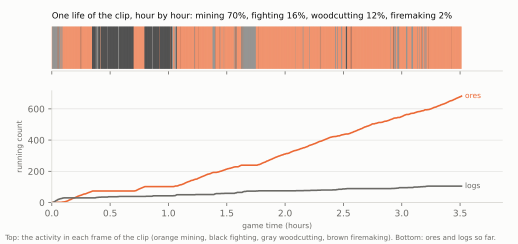
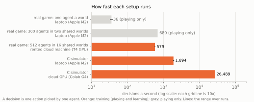
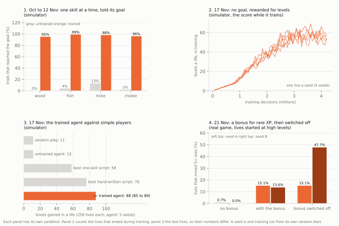
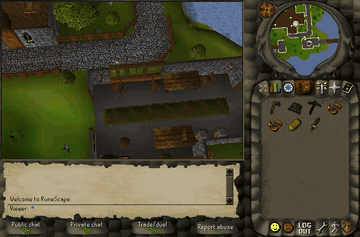
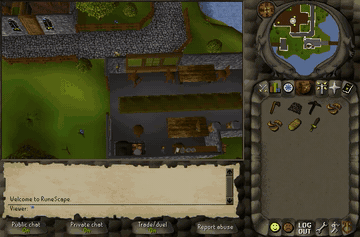
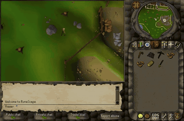
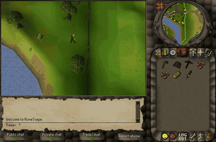

# Notes: the long version

This is the deep dive behind the [README](../README.md). It's one long page, so jump around with
the contents below (or GitHub's outline button at the top right of the file).

**Contents**

1. [RL in five minutes](#1-rl-in-five-minutes)
2. [The game and the environment](#2-the-game-and-the-environment)
3. [Rewards](#3-rewards)
4. [The training setup](#4-the-training-setup)
5. [How I measure it](#5-how-i-measure-it)
6. [Results](#6-results)
7. [What's next](#7-whats-next)
- [Appendix A: how I got here](#appendix-a-how-i-got-here)
- [Appendix B: the 12 November results in detail](#appendix-b-the-12-november-results-in-detail)

## 1. RL in five minutes

Reinforcement learning (RL) is learning by trial and error. An **agent** acts in an
**environment**. After each action, the environment sends back an **observation** (what the
agent can see now) and a **reward** (a number that says how well that went). The agent's
**policy** picks the next action from what it sees. Training nudges the policy toward actions
that led to more reward. Deep RL uses a neural network as the policy, and that's what this
project does.

Before building anything, it helps to break the problem into six parts. Here they are for one
of the first tasks in this project, "cut 8 logs in 3 minutes":

- **Goal**: have 8 logs in the inventory after 300 ticks (3 minutes), and be alive.
- **Environment**: the game around a few groups of trees.
- **Observation**: what's within 15 tiles, the inventory, the open menu and the game's text.
- **Actions**: walk by clicking a nearby tile, chop a tree, drop an item, and so on.
- **Reward**: the logs still held at the end, and nothing if the agent died.
- **Policy**: a small neural network. At the start it clicks at random, and over many tries it
  learns that chopping trees pays.

Then I took the goal away. In goal-free play there's no task at all: the agent plays a whole
life, and the reward is the levels it gains. Everything else stays the same. The rest of these
notes are about what happens when you do that.

### Terms used here

- **Agent** (or **policy**): the program that plays, a neural network with about 2.5 million
  parameters. It has a short-term memory, an LSTM (long short-term memory, a common type of
  recurrent network), and is trained with PPO (Proximal Policy Optimization), a standard RL
  training method. More in [chapter 4](#4-the-training-setup).
- **Tick**: the game's clock. One tick is 0.6 seconds, so 6,000 ticks is an hour of game time.
- **Decision** (or action): one choice by one agent. One decision can last 1 tick (eat) or over
  100 (walk somewhere far).
- **Skill, XP and level**: RuneScape has skills like Woodcutting, Mining and Attack. Doing a
  skill earns experience points (XP), and enough XP raises that skill's level.
- **Life** (an episode, in RL terms): from when an agent appears until it dies or hits its time
  limit.
- **Update**: the agent plays a batch of 65,536 decisions, then learns from them once. A training
  run is a few dozen updates.
- **Seed**: one training run, started from its own random numbers. Two seeds means the same
  recipe trained twice. If both agree, the result is less likely to be luck.
- **Simulator** vs **real game**: the simulator is my C rewrite of the game's rules. The real game
  is the actual server code ([rs-sdk](https://github.com/MaxBittker/rs-sdk), an open-source copy of
  the 2004 game server) with a few patches of mine.
- **Script**: a simple hand-written player, used only as a yardstick or to check that something
  is possible. The agent never learns from scripts.

If you want more RL background, the classic book is
[Sutton and Barto](http://incompleteideas.net/book/the-book.html) (free online), and the
[Hugging Face Deep RL course](https://huggingface.co/learn/deep-rl-course/unit0/introduction) is a
friendly hands-on start.

## 2. The game and the environment

### What is RuneScape?

RuneScape is an online role-playing game. This project uses the 2004 version. You walk around
an open world, and there are 21 skills to train: Woodcutting, Mining, Fishing, Cooking, Attack,
Prayer and so on. Each skill goes from level 1 to 99. Cutting a tree gives Woodcutting XP,
killing a chicken gives Attack (or Strength, or Defence) XP plus Hitpoints XP, and so on. There's
no main quest you must finish. Players pick their own goals.

### Why is it a hard RL problem?

- **There's no goal.** The game doesn't tell you what to do, so the agent has to find its own
  things to do.
- **Lives are long.** A life here lasts 1 to 6 hours of game time. The life in the README's clip
  is 21,073 ticks and 2,692 decisions.
- **Skills need setups.** Firemaking needs logs and a tinderbox. Mining needs a pickaxe and a
  walk to a rock. Cooking needs raw food and a fire. Nothing pays until all the pieces are there.
- **The agent only sees 15 tiles around it.** A fishing spot 30 tiles away doesn't exist to it
  until it wanders close.
- **It's a real game server.** Creatures attack you, items have quirks, and a decision can take
  1 tick or 100.

### The world

Training happens on the real game map, around the villages south of Falador. Every life starts
within 16 tiles of one of six spots: Port Sarim north, Draynor west, Falador's farm, the
Rimmington coast, the mine west of Rimmington, and south of Draynor Manor. Each life draws its
starting levels, hitpoints and kit from a fixed set of start records. The kit is 1 to 3 pieces of
food, an axe, a pickaxe, a fishing net, sometimes a worn weapon, and (since 19 November) a
tinderbox. A life ends when the agent dies or hits its drawn time limit of 1 to 6 hours.

Some newer test runs start every second agent at the levels of a long life instead (woodcutting
50, firemaking 52, attack 31, strength 37, defence 30, hitpoints 34). That's how the clip in the
README started.

### What the agent sees

The observation is roughly what a player standing there would see:

- every object, creature and item on the ground within 15 tiles, with its position and what you
  can do with it;
- its inventory, shown as one entry per kind of item;
- the open menu and the game's recent text messages.

Names matter here: "Tree", "Oak", "Rocks", "Raw chicken". The agent reads each name as a text
embedding, a list of 384 numbers from all-MiniLM-L6-v2, a small open text model. So similar
names get similar numbers, and the agent can carry over what it knows to things with related
names. There's no map, no minimap and no wiki. Its only memory is the LSTM.

### What it can do

The agent has 96 actions:

- walk by clicking one of 24 tiles around it (4, 9 and 16 tiles out, in eight directions);
- act on something within 15 tiles: chop, mine, attack, pick up, talk, open;
- use one item on another, like a tinderbox on logs;
- eat, bury, drop, wait, and click through menus.

The game says which actions are possible right now, and only those can be picked. That filter
only removes impossible actions. Nothing ever removes an action because of a goal or a skill.

### The simulator and the real game

There are two copies of the world. The **simulator** is my rewrite of the game's rules in C: a
Python reference version first, then a C port that has to match it decision for decision. It's
fast but only knows the mechanics I ported. The **real game** is the actual server code. It's
slower but has everything. [Chapter 4](#4-the-training-setup) has the story of both and how fast
each runs.

## 3. Rewards

Reward design is where most of the thinking in this project goes. The agent will do whatever
pays, including things you didn't mean to pay for.

### Phase 1: items and kills

The one-skill tasks (cut 8 logs, catch 2 fish, mine 2 ores, get 5 kills) paid for items the
agent made and still held at the end, plus kills, and nothing if it died. I picked this after a
bad first try: paying for XP let an agent earn XP, die, lose its axe and logs, and still look good.

### Goal-free: levels gained

In goal-free play the reward is the levels gained, over every skill, counted in fractions. If
a skill is at level $L$ with $x$ XP, and level $L$ starts at $X(L)$ XP, its fractional level is

$$\ell(x) = L + \frac{x - X(L)}{X(L+1) - X(L)}$$

Each decision is rewarded with how much the sum of $\ell$ over all skills went up. Every reward
is checked against the game's own XP records, so a bug can't pay for something that didn't
happen.

**Why levels and not XP?** Each level costs more XP than the one before:

| Skill level | XP needed for the next level |
| --- | --- |
| 1 | 80 |
| 16 | 231 |
| 30 | 607 |
| 44 | 1,595 |
| 50 | 2,412 |

So rewarding levels means a skill that's far behind pays more than one that's far ahead. If I
rewarded raw XP, the best plan would be to grind one skill forever. With levels, the same item
gives less reward the higher its skill gets:

One iron ore (35 XP) is worth 0.15 levels at mining level 16 but only 0.02 at level 44. In
practice the agent drifts toward wherever levels are cheapest right now.

### What drives each behavior

- **Woodcutting**: trees are near every start and it carries an axe. At low levels this is the
  easiest reward around, so a fresh agent cuts wood in practically every life.
- **Firemaking**: once it had a tinderbox, its own logs became extra reward.
- **Fighting**: creatures are everywhere, and each fight trains two skills at once (a combat
  skill and Hitpoints).
- **Burying bones**: fights drop bones, and burying them trains Prayer, which starts at level 1,
  so it's cheap.
- **Mining**: it carried a pickaxe in every life, and one of the six start spots is right next
  to a mine. It still never mined until the rarity bonus below.
- **Fishing and cooking**: fishing spots are usually out of view (more than 15 tiles away), so it
  never stumbles on them. Even with a fishing spot in view at the start, only 1 of 60 lives
  caught five fish or more. No fish means no cooking.
- **Eating**: health gives no reward. Food only matters because dying ends the life early, and
  that's a weak, delayed signal. It mostly eats at full health, if it eats at all. It also drops
  its food early in a life to make room for logs.

### Why does the agent in the clip mine so much?

Three reasons:

1. **It started at high levels.** The clip's life started at the levels of a long life
   (woodcutting 50, firemaking 52, combat skills 30 to 37), where those skills are expensive,
   while its mining was only 16. One iron ore was worth about 15 times as much reward as one log.
2. **It started right next to a mine.**
3. **Training with the rarity bonus taught it that mining exists.** Before that bonus, policies
   started at the same high levels fought about 90% of the time and never mined once.

Here's that life hour by hour:

It mines from the first minutes, takes two long breaks to fight, and then mostly mines for the
last two and a half hours, with a few short woodcutting breaks. This edge doesn't last forever: each mining level costs more than the last,
and a script that only mines beats the old fighting policies over the first 10,000 ticks or so,
but not over 30,000.

### The knobs

| Knob | What it changes | Tried? | What happened |
| --- | --- | --- | --- |
| Start levels | which skills are cheap | yes | high starting levels: fights about 90% of the time |
| Start location | what's in view at the start | yes | a fishing spot in view: 1 of 60 lives caught 5+ fish |
| Which skills count | 7 skills, then every skill plus a tinderbox | yes | fires and bones showed up (with more exploration) |
| Exploration strength (an entropy bonus, which rewards keeping its action choices random) | how much it tries new actions | yes | 5x for a while helped fires and bones, not mining |
| Rarity bonus (a count-based exploration bonus) | extra reward for XP in skills it rarely trains | yes | brought mining in both seeds, and it stayed after removal |
| Death penalty (minus 50 levels when it dies) | how much dying hurts | yes | no change in deaths |
| Weights per skill (say, woodcutting counts double) | how much each skill is worth | no | not built yet |

The rarity bonus is the one that worked best, so here's exactly what it does. Every decision
that earns XP in a skill gets an extra reward of $10 / (10 + R)$, where $R$ counts the run's
recent decisions (the last 131,072) that earned XP in that skill. A kind of XP the agent almost
never gets pays close to a full level. One it gets all the time pays almost nothing. The bonus
never names a skill, and every result is still judged on the plain level reward alone.

**More woodcutting?** The surest knob is to make woodcutting levels cheap again: start lives at
low woodcutting, near trees. Weighting woodcutting higher in the reward would also work, but
that's me picking its hobby for it, which is the opposite of the point.

**More exploring?** The two exploration knobs (entropy and rarity) both pushed it into new
skills. A bonus for visiting new places isn't built yet, and it's probably the next thing to try
for fishing.

### What didn't work

These were all tested against an unchanged control run, and none were kept:

- **A death penalty** of 50 levels: deaths didn't change.
- **A reward for health** that paid for each drop and rise in hitpoints. Over a life it adds up
  to "health at the start minus health at the end", so it can't pay for healing sooner than
  just waiting. That's a math problem, not a tuning problem.
- **A charge for time spent hurt**: the agent fought less and was hurt less, but didn't reliably
  learn to eat (the two seeds disagreed).
- **A bonus for the first time it holds each kind of item**: it picked up raw food, and still
  never cooked.
- **A bonus for the first time it uses each item on each thing**: it brought the first cooked
  food, then the agent farmed it, earning five times more bonus than real levels.
- **Raw food in the starting kit**: no cooking. The kit was almost never on the inventory page
  the agent could act on, so it never really had the chance.
- **Learning from its own best lives** (self-imitation): it cut the take-up of new skills to
  about a fifth.

The lesson I keep relearning: any bonus can be gamed, so a bonus has to fade, and every verdict
has to use the plain level reward alone.

### Scripted vs. learned

Some game RL projects script the hard parts, like managing the inventory or using a special
item at the right moment. I keep that list empty:

- the environment never acts for the agent (no auto-eating, no auto-banking, no forced walks);
- there are no hand-written rules that pick a skill, and no action filter based on a goal;
- scripts exist only as yardsticks, and to check that something can be done at all (a script
  fished, lit a fire, cooked and ate through the same 96 actions, which proved those skills are
  reachable and correctly rewarded).

That's also part of why fishing and cooking aren't learned yet: nothing hands the agent the first
step.

## 4. The training setup

### The policy network

The policy has about 2.5 million parameters. Each thing in view becomes a row: its name
embedding plus numbers like its position and what you can do with it. An encoder turns those rows
into a summary, and an LSTM with 128 units carries memory from one decision to the next. Small
output heads then score the possible targets of each kind of action (things to act on, tiles to
click, items to use or drop). The actor (which picks actions) and the critic (which estimates how
much reward is coming) each have their own encoder and LSTM. Most of the weights sit in the
encoders' first layers.

### PPO

PPO (Proximal Policy Optimization) is a standard RL training method. Each update, the agent plays
a batch of 65,536 decisions. For each decision, PPO estimates how much better or worse it went
than the critic expected (the "advantage"). Then it nudges the policy toward the better actions,
but only a little each update. That's the "proximal" part: changes that move the policy too far
are clipped. The settings here are minibatches of 1,024, 4 passes over each batch, a learning
rate of 0.0003, a clip of 0.2 and an entropy bonus of 0.01. Future rewards are discounted with a
half-life of 6,000 ticks, so a level an hour of game time away counts half as much as one now.

### From slow to fast

The real game server is slow for training. One world on my laptop made only a few dozen
decisions a second (33 to 45 in different measurements), and four worlds together weren't
faster, since each world eats a whole CPU core. A fresh PPO run took about an hour for 65,536
decisions, so one 4.2-million-decision run would take almost three days.

So on 15 October I wrote a simulator: a Python copy of the mechanics the tasks need, ported from
the server's source and checked against recorded real games. Its path finder matched the real
one on all 6,000 test queries. Python tops out around 1,000 decisions a second per core, though.

I also built a JAX version that runs a thousand worlds at once on a GPU. On a rented A100 it
trained at 654 decisions a second against 549 for plain Python workers on the same machine, and
it spent about 20 minutes compiling before its first step.

**Why didn't the GPU help?** [Craftax](https://arxiv.org/abs/2402.16801) puts the game, the
rollouts and PPO in one JAX program and gets about 267,000 steps a second on one RTX 4090.
[Neural MMO 3](https://github.com/PufferAI/PufferLib) in PufferLib is plain C and runs millions of
steps a second per CPU core. The difference that mattered: every Craftax step costs about the
same, and mine don't. One decision can last 1 tick or over 100. On a GPU all worlds step
together, so the batch waits for the slowest world, and only about 8% of the work was useful. On
CPU cores each world runs on its own clock.

So I followed Neural MMO 3 (none of its code is used here) and rewrote the simulator in C, about
12,000 lines, on 26 and 27 October. The Python version stays the reference, and the C port has
to match it decision for decision. Its release check compared 6.3 million decisions with zero
differences. One core steps about 100,000 random decisions a second, about 100 times the Python
version.

### Training in the real game

The simulator only knows the mechanics I ported, so an agent trained there never meets anything I
left out. In November I got the real server fast enough to train in by sharing worlds: many
copies of one policy (32 agents in each of 16 worlds) play in the same game worlds at once. Each
world pauses whenever an agent needs a new action and while the learner updates, so the game
never moves on while an agent is still deciding. A 25-update run takes about 45 minutes on one rented machine
with a T4 GPU and 32 CPU cores.

The C simulator still trains about 45 times faster than the real game, so it stays as the fast,
tested twin. The goal-free results since 18 November were trained in the real game.

### A bug that hid for three weeks

In the game, when something hits you, you hit back automatically. My agent never did, because
the damage code cleared the queued hit-back in the same pass. The Python reference and the C port
had the same bug, so the check that they agree passed anyway. It was there from mid-October, so
phase 1 trained without it. I found it in November while digging into why agents got stuck.

After the fix I replayed the phase 1 policies. The melee ones still pass in every seed (758 to
782 of 800), and the shared four-skill policy now passes melee in all five seeds instead of two.
That doesn't say what training with the fix would do, since those weights learned without it.
In the real game, an idle player hit back in 16 of 16 trials, which is the rule the fix follows.

## 5. How I measure it

- **Tests are fixed before training.** The pass marks, the test starts and the numbers I'll read
  are written down before a run starts, so I can't move the goalposts after.
- **The agent plays with its normal randomness.** It samples each action from its learned
  probabilities, the same way it plays during training. Always taking the top pick (greedy) can
  give a very different answer: one saved policy scored 23 of 200 greedy and 139 of 200 sampled.
  So only sampled play counts.
- **Unseen starts.** The one-skill tests start from records (start tile, levels, kit) drawn before
  training and never trained on.
- **Yardsticks.** Every score is shown next to random play and simple scripts on the same starts.
- **The real game.** Agents trained in the simulator are always checked in the real game. There's
  also a fixed test called the watch: the same four places and settings every time.
- **The game's records check the reward.** An audit compares every rewarded level with the game's
  own XP records.
- **Two or more seeds.** A result counts only when the seeds agree. The goal-free tests say each
  of their planned sentences only if its rule holds in both seeds.

## 6. Results

### Phase 1: one skill at a time (October to 12 November)

One policy per skill, five seeds each, pass marks fixed before training, each policy told its
goal. Everything here used 25 times the normal XP rate.

| Wood | Fish |
| --- | --- |
|  |  |
| **Mine** | **Melee** |
|  |  |

In the simulator (200 starts per seed and test pass, 800 for melee):

| Skill and goal | Policy | Items per test | Reached the goal | Median ticks to the goal |
| --- | --- | --- | --- | --- |
| Wood: 8 logs in 300 ticks | Untrained | 1.3 logs | 0% | - |
|  | Phase 1 | 11.7 logs | 95% | 202 |
|  | Clicks | 10.3 logs | 80% | 219 |
| Fish: 2 fish in 240 ticks | Untrained | 0.3 fish | 4% | 105 |
|  | Phase 1 | 3.0 fish | 99% | 89 |
| Mine: 2 ore in 240 ticks | Untrained | 0.7 ore | 13% | 144 |
|  | Phase 1 | 3.3 ore | 98% | 94 |
|  | Clicks (1 seed) | 2.7 ore | 87% | 115 |
| Melee: 5 kills in 1,200 ticks | Untrained (1 seed) | 0.9 kills | 2% | 1,011 |
|  | Phase 1 | 9.6 kills | 96% | 449 |
|  | Clicks (1 seed) | 7.7 kills | 90% | 609 |

In the real game (32 tests per seed and test pass, at two places per skill):

| Skill and goal | Policy | Items per test | Reached the goal |
| --- | --- | --- | --- |
| Wood: 8 logs in 300 ticks | Untrained | 0.8 logs | 0.3% |
|  | Phase 1 | 14.2 logs | 99% |
|  | Clicks | 13.5 logs | 94% |
| Fish: 2 fish in 240 ticks | Phase 1 | 1.9 fish | 65% |
| Mine: 2 ore in 240 ticks | Phase 1 | 2.3 ore | 79% |
|  | Clicks (1 seed) | 1.4 ore | 52% |

"Items" is the average per test, misses included. "Ticks" is the median tick at which a test
reached its goal, among the tests that did. "Phase 1" is five seeds per skill, each tested twice.
"Clicks" is the later controls (next section). "Untrained" is the starting policy (for melee, the
start of the click run). The wood test uses a sparse map where only one tree is left near the
start.

Wood passed everywhere. Melee passed in the simulator, but there's no fair real-game test for it
(no real start puts a mugger near goblins, and nothing resets hitpoints). Fish and mine passed in
the simulator in every seed and mostly failed in the real game. Real places are full of things
the training world never had. At Entrana, a second fishing spot has the same name as the net
spot but needs a rod, and most failed fish tests loop on it, though I haven't proven that's the
cause.

I also let the wood agent play the real game for a full hour. It fills its bag within the first
12 minutes and then mostly stands around. My guess is that training lives only lasted 300 ticks,
so it never learned what to do with a full bag. That's one reason goal-free lives are long.

### Clicking instead of walking to named places

The phase 1 controls walked to named places up to 32 tiles away. That's not how a player moves,
and the list of places gives away where things are. In early November I switched to clicking one
of 24 tiles around the player. The click-trained wood policy still passes its real-game check, but
it's slower to find the next group of trees and fails the sparse-trees test in two of five seeds.
I kept clicks anyway, as a choice. Mine and melee with clicks learned in the simulator (one seed
each), but mining didn't carry over to the real game.

### Goal-free play (12 to 21 November)

Every task up to here told the agent what to do. The next question was whether it would find
things to do by itself, so I dropped the goal.

**In the simulator** (17 November, five seeds), the goal-free agent gained 85 to 89 levels a life.
Random play gets 11, the best one-skill script 58, and my best hand-written script (attack
chickens forever) 76. All five seeds learned the same way.

**In the real game** (from 18 November), it picked up four skills on its own: woodcutting,
firemaking, fighting and burying bones. In one seed's lives near the end of training, 100% cut
wood, 95% made fires, 69% fought and 37% buried bones. Then it stopped. Across four tests (a
charge for time spent hurt, the first-use bonus, lives started at a long life's levels, and a
phase of extra exploration) it moved between the skills it knew and never tried a new one, even
with a rock a step away.

**The rarity bonus** (21 November) changed that. On lives started at a long life's levels, the
share that mined five ores or more went from 0.7% and 0.0% without it to 15.1% and 13.6% with it
(two seeds). After 25 more updates with the bonus switched off, mining stayed and grew, to 15.1%
and 47.7%, and those lives gained more levels than lives that never had the bonus. The bonus got
it to try, and the normal level reward made it stick.

**Specialists.** The same agent changes its focus with its situation, with no new goal and no
script. From a fresh start it cuts and burns wood and fights. Started at a long life's levels,
where those skills pay little, it becomes a fighting specialist and spends 90 to 93% of its time
fighting. A short phase with the rarity bonus (25 updates, then 25 more without it, about 45
minutes each) made it a mining specialist. The clip in the README is that miner: one life of
21,073 ticks, mining 69.5% of the time, mining level 16 to 44, 683 ores, 105 logs, 57 fires, 24
bones buried, no death.

**Limits.** Two seeds. Mining only shows up on the high-level starts (lives at normal starting
levels still rarely mine). Deaths went up on small counts (19 and 10 against 9 and 7 with the
bonus, 20 and 23 against 9 and 7 after it). It doesn't fish or cook, and it almost never eats when
hurt.

## 7. What's next

Ideas, not promises:

- **Fishing**: a bonus for visiting new places, so the agent finds fishing spots outside its
  15-tile view.
- **Eating when hurt**: nothing I've tried teaches it. Maybe a longer view of the future, maybe a
  better way to see the inventory.
- **More seeds** for the mining result, and lives at normal starting levels.
- **Banks and shops**: no training run has reached a bank yet, and no action can reach a shop's
  buy or sell buttons (a script banked in 16 of 16 tries, so it's possible).
- **The published weights**: so far a rebuilt name table is only tested on one Mac.

## Appendix A: how I got here

### Starting in the real game

I started at the end of July 2026 by hooking an agent straight into the game server. The first
agent had one policy for woodcutting, mining, fishing and combat, and it was paid in XP. Two
things went wrong. The server's player has no "is dead" field, so for a while my agent could die
and I never saw it. XP was also the wrong thing to pay for, since an agent can earn XP, die, lose
its axe and logs, and still look good. So in late September I switched to paying only for items
the agent made and still held at the end, with nothing if it died, plus kills.

### Copying a scripted teacher

Next I tried imitation. I wrote a scripted player, had the agent copy it, then fine-tuned with
PPO. Copying worked at Draynor, but PPO fine-tuning made it worse, until it kept almost no logs.
My best guess was the critic: copying only trains the actor, so PPO starts with a random critic.
The copied policy had also learned Draynor rather than woodcutting. At two villages it had never
seen, it got 0 logs. Training on four villages fixed one unseen bank (15 of 16 trials at Varrock
west) but not the other (0 of 16 at Varrock east). Through early October I kept adding labels and
tricks, with mixed results.

### Learning from outcomes only

On 13 October I dropped the teacher and trained PPO from scratch on short tasks at Draynor, paid
only by the outcome. It learned woodcutting in all 3 seeds and fishing in 1 (the other two just
chopped trees instead). Since then everything here has been trained this way, with no teacher
and no demonstrations.

### Detours that didn't pan out

Before the C port, I spent a week trying to teach one policy new skills without it forgetting the
old ones: a novelty bonus (random network distillation), continual backpropagation,
self-distillation and PCGrad (which resolves conflicting gradients between tasks). None were good
enough to keep. The most useful thing from that week was about testing: greedy and sampled play
can disagree wildly, so now only sampled play counts.

## Appendix B: the 12 November results in detail

These are the full results of the one-skill-at-a-time policies, with how far to trust each
number.

### How to read the numbers

A success is counted on records (start tile, levels, kit) drawn before training and never trained
on: "172 of 200" means 172 successes on 200 such records. Sampled play draws each action from the
policy, as in training; a verdict needs two sampled passes, and both must pass. Greedy play always
takes the top action and is only reported beside ([why](#greedy-and-sampled-play)). "Native" means
the real game. The native check is 32 trials, 16 at each of two sites, and needs 26. Training,
gates and native checks run at 25 times the normal XP rate. Points are percentage points.

Wood is 300 ticks among three groves; success is 8 logs and staying alive. In `ample` the start
grove is as drawn; in `scarce` one normal tree is left, so the agent has to find another grove.
Fish and mine are a 240-tick task: get 2 of the asked-for item first, keep them, stay alive. Melee
is 5 kills in 1,200 ticks against goblins and muggers that hit back, with health and food carried
between fights, on 800 records in four start groups of 200 (healthy, hurt with food, hurt without
food, a mugger nearby). Code: [sim/search.py](../sim/search.py), [sim/combat.py](../sim/combat.py).

### Phase 1 numbers

One specialist per skill and one shared four-goal policy, five seeds each, 4,194,304 decisions a
run, with the older controls: compass moves plus walks to named places up to 32 tiles away. A skill
is supported when its specialist passes the simulator gate in all five seeds and the native check
in at least four, both sampled passes each time.

| Skill | Simulator, sampled | Native check, sampled | Greedy, reported only | Verdict |
| --- | --- | --- | --- | --- |
| Wood | Every seed passes: `ample` 197-200, `scarce` 184-195 of 200 (gate 160) | Every seed passes: 31-32 of 32 | - | Supported |
| Fish | Every seed passes (fish and mine 191-200 of 200) | Every seed fails: 16-25 of 32 | Native 29-32 of 32 | Not supported |
| Mine | Every seed passes | 19-30 of 32; under 26 in a pass in 4 of 5 seeds | Native 25-32 of 32 | Not supported |
| Melee | Every seed passes: 755-774 of 800, each group at least 176 of 200 | None exists | Simulator 656-775 of 800 | Supported, simulator only |

Melee has no native check: no native spawn puts a mugger 6-12 tiles from goblins, nothing spawns
npcs, and no reset sets hitpoints. The fish and mine short tasks are near saturation in the
simulator; the native check is where they fail. Limits: 32 native trials is a small sample (near 26
the binomial standard deviation is about 2.3, and a repeat of the check moves about 2), fish's 32
native records are 16 starts on two engine builds, and melee trained before the
[auto-retaliate fix](#a-bug-that-hid-for-three-weeks).

### One policy for four skills

In the simulator the shared policy passed wood, fish and mine in all five seeds and melee in two
(the misses were all the mugger group in one pass, 135-139 of 200 against 140). Natively it failed
wood (9-26 of 32) and fish (9-21) in all five seeds and passed mine in two (26-28). Interference at
equal experience per skill (a specialist at a quarter of its run against the shared final) was not
shown either way. At equal total compute the melee specialist beat the shared policy by 8.75 to
13.88 points in every seed and pass (each lower bound at least +6.12); for the other skills,
specialist minus shared ran from -4.00 to +5.00.

### Why fish and mine fail in the real game

Open. This is an association in 1,920 saved native trials (replayed exactly), not tested by training.

- Native sites hold many things the training world never shows (about 8 of the 12 listed places).
  At Entrana a second fishing spot has the net spot's name but offers Lure and Bait (both need a rod).
  The policies put 0.14-0.23 of their probability on such things at the goal site (0.18-0.26 on the
  goal action), and sampled play takes them 5.5-5.9 times a trial, greedy 2.5.
- Fish trials with 5 or fewer such actions succeeded 174 of 200; with 6 or more, 34 of 120 (mine:
  171 of 195 against 85 of 125). 75 of 112 sampled fish failures loop at the Lure/Bait spot,
  against 8 of 208 successes. But 33 of those 75 never had the Net option in range, so a loop that
  causes a failure cannot be told from a failing policy that loops. Had every loop succeeded, three
  seeds would reach 26 in both passes; four are needed.
- Adding native-like content to a simulator world, with fixed policies, raised off-goal actions to
  native levels in only 3 of 5 seeds, and the fish drop showed in no seed: a failed manipulation.

### Clicks instead of place walks

The current controls walk by clicking one of 24 tiles around the player (4, 9 and 16 tiles out in
eight directions; [rl/act_contract.py](../rl/act_contract.py)) and act on things within 15 tiles.

**Wood, five seeds.** The click-trained wood policy passes its native check (28-32 of 32) and
`ample` (189-196 of 200) in every seed, but misses `scarce` in two: 147 and 152 in seed 101, 159 in
one pass of seed 202, against 160. So it fails the wood rule; the phase 1 specialists pass the same
records (`scarce` 191-196). Against them it loses 32.7 of 200 on `scarce` on average (SD 7.5 over
seeds) and 1.3 of 32 natively. It did learn to leave an empty grove (it went on to logs elsewhere in
194-200 of 194-200 such trials per seed and pass) but runs out of time between groves: a median
56-57 ticks to the next log, against 41-43 for phase 1; 84-88% of its failures ended with 5-7 logs.

My guess was that it lost the place list's knowledge of where the next tree stands. For scripts that
holds: on 100 `scarce` records, a click script with no tree knowledge made 77, one that knows trees
within 25 tiles 94, within 32 tiles 97, an oracle 99; the click policy made 71-82, phase 1 94-98. But
14.6 of the policy's 20.2-record gap lies on records the blind script already wins, so this does not
show knowledge is what the policy lacks. The native check asks for little walking (0.6-3.5 clicks a
trial, against 6.4-8.2 in `scarce`). Clicks became the default anyway: a choice, not a pass.

**Mine and melee, one seed each,** trained with the same recipe on a Mac, 4,194,304 decisions
each, on the simulator after the retaliate fix:

| Read | Sampled, two passes | Greedy | Untrained start | Line |
| --- | --- | --- | --- | --- |
| Simulator melee, of 800 | 729, 713 | 663 | 15, 19 | 640 |
| Simulator mine, of 200 | 172, 176 | 148 | 22, 28 | 160 |
| Native mine check, of 32 | 17, 16 | 21 | - | 26 |

Both learned in the simulator; native mining did not transfer. At Rimmington the starts lie 8-14
tiles from the nearest rock, and 33 of 48 sampled trials never asked to mine. Once a click or action
left no rock to mine in the list, one came back within 12 decisions in 4 of 37 cases, against 166 of
184 in training; why is not shown. At Varrock south-east it made 13 and 14 of 16. The native combat tests
gave 1 of 16 in both cells but are not the trained task: one has chickens behind a closed gate
(training had none), the other starts 25-40 tiles from goblins, past the 15-tile list. Limits: one
seed each, and the Mac's update path is not the GPU path.

**Retraining mine on three seeds.** The idea: the small training world (8 layouts of 48 x 48 tiles,
rocks east of 69% of their start tiles) causes the mine gap. At fixed weights, on 64 new Rimmington
starts per side, the one-seed policy made 32 and 35 with rocks to the west and 49 and 46 with rocks
to the east, and its clicks went east 1.7-1.9 times as often as west (greedy play did not show the
side difference; a script made 16 of 16). The rule, set before training: retrain the same recipe on
a cloud GPU at three seeds; if two hold the rocks-west cell at 52 of 64 in both passes, the gap
belongs to that one run, and the bigger-world run (128 layouts) does not train. Seeds 101 (54, 58)
and 303 (57, 53) held it, 202 (48, 55) did not, with simulator mine at 177-186 of 200. So the study
stopped, and the small-world idea was never tested. Limits: one site, the one that suggested the
idea; thin margins (seed 303 held by one trial); with one Mac run, the Mac's update path cannot be
told apart from run-to-run noise.

### Long real-game play

The phase 1 wood specialist and the shared policy (fixed weights, five seeds) played hour-long native
episodes at Barbarian Village, three passes (two sampled, one greedy) of 40 hours each. In the first
1,200 ticks they made 21.4-24.5 and 18.9-24.6 logs, then 0.00-0.75 and 0.00-2.69 in each later
1,200-tick window. The specialist filled its inventory in the first window in 39, 40 and 40 of 40
hours, then mostly stalled. It is not mainly deaths: per 1,000 ticks alive it made 0.31, 0.33 and
0.14 logs after the first window, against 19.7, 19.3 and 18.4 in it. It died in 26, 25 and 11 of 40
hours, most often to an aggressive npc named Tree that cannot be chopped; the shared policy died in
30, 31 and 20, mostly after asking to attack its killer's kind. Untested guesses: training lasts 300
ticks, but the inventory filled at a median of 435-467 ticks; and the training reward stops at 20
logs. Limits: one site, fixed weights, older controls.

### Speed

- **C simulator** ([sim/native/](../sim/native/rs.h)). Its release check compared 429 cases,
  6,305,640 decisions and 61,669,351 ticks against the Python reference with 0 differences. On a
  Mac one worker steps 104,055-106,448 random decisions a second against 1,020 for Python, about 100
  times faster. The agreement check ([sim/native_harness.py](../sim/native_harness.py)) cannot
  catch a mistake both share.
- **Learner.** One 65,536-decision update at minibatch 256 on the GPU below: 41.5 s with stock
  Stable-Baselines3, 12.2-13.1 s on my earlier path, 9.6 s with the new update (bit-equal to stock
  on CPU), 5.5 s with CUDA graphs.
- **Training rate.** On a cloud machine with one NVIDIA RTX PRO 6000 Blackwell GPU and 48 vCPUs,
  with 16 C workers: 36,174 decisions a second at minibatch 1,024, against 2,424-2,510 with the
  Python simulator (which capped it near 6,200). The phase 1 runs trained at 27,597-29,286. The
  real game, for comparison, ran about 39-41 decisions a second on a Mac (one short sample).

### Greedy and sampled play

The policy is trained by sampling, and taking the top action instead gives a different policy. On
the same 200 hidden-tree search records, one saved policy (a seed's starting policy in the search
study) made 23 successes greedy and 139 sampled: 58 percentage points apart (116 of 200 records).
Two of three earlier retention losses disappeared under sampling; one persisted (-13.5 and -15.0
points). Greedy play can sit in confident loops by its start tile, repeating WAIT, inventory pages
or style changes. Two sampled passes also differ, by 6-11 of 200. Now sampled play decides gates.

### Before phase 1, and methods beside plain PPO

Earlier studies used three seeds, mostly with greedy gates. Four-goal short-task policies passed
all 12 seed-goal conditions on 200 new layouts (164-200), but natively 17 of 27. No seed passed
every sustained-combat gate. Plain PPO learned hidden-tree search (greedy 196, 189 and 197 of 200)
and 300-tick wood (178-197 per variant), losing some combat skill. Tried beside it, none adopted:

- **Random network distillation.** About 2.2 times as many decisions per episode, a shift to short
  interface actions, fewer kills, and 21.5 to 41 points of combat lost against the start in every
  seed; search was not better. Likely reason, not tested: the bonus is paid per decision.
- **Continual backpropagation,** with that bonus and then alone. Alone it showed no combat benefit.
- **Self-distillation** kept slightly more of the earlier
  skills and blocked the new learning.
- **Targeted self-distillation** learned the new task, but greedy search fell to 141 and 139 of 200
  in two seeds (sampled 188 and 192), and it missed the combat floor and the recovery bounds.
- **PCGrad** met every rule in two seeds and lost combat in the third: 583 and 568 of 800 against
  its start's 659 and 654. A follow-up gradient check was inconclusive. The code for the bonus,
  continual backpropagation, the distillation and PCGrad is not in this repository.

### What wasn't done in phase 1

- No training run has reached a bank, and bank actions pay nothing; a script showed the click
  controls can bank (deposit, withdraw, walk back, chop again) in 16 of 16. No action reaches a
  shop's buy or sell buttons: Trade opened the shop in 16 of 16, then only WAIT and close were legal.
- Mine and melee under clicks are one-seed runs (three for the mine retrain), fish has no click
  policy, melee has no faithful native check, and every one of these tasks gives the agent its goal.
